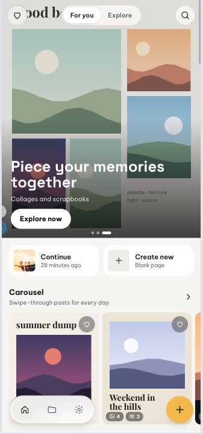
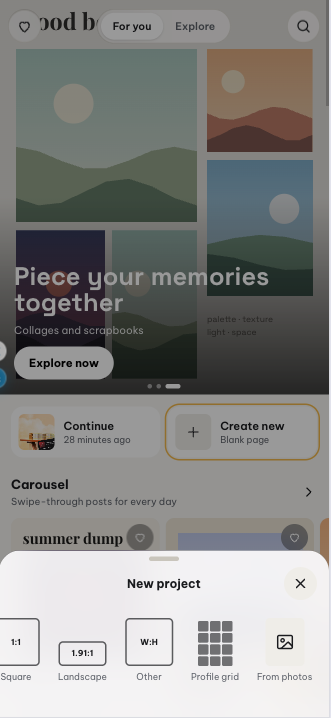
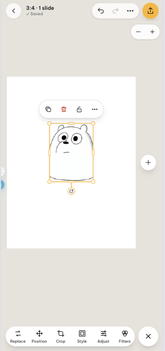

# IG Layout

Web app (PWA) miễn phí để chỉnh ảnh, cắt ảnh và dựng layout cho Instagram: carousel vuốt ngang liền mạch, collage, ảnh chồng lớp kiểu scrapbook, cắt lưới trang cá nhân, Story. Thiết kế xong thì tải ảnh về máy và tự đăng. App không đăng thay bạn, không cần tài khoản, và mọi ảnh được xử lý ngay trên máy bạn.

**Dùng thử:** https://ig-layout.vercel.app/ (cài lên màn hình chính như một app)

  
  
  

## Làm được gì

- **Carousel liền mạch**: một ảnh panorama trải qua nhiều slide, xuất ra từng ảnh đúng kích thước Instagram (1:1, 4:5, 3:4, 1.91:1, 9:16 hoặc tỉ lệ tuỳ chọn).
- **Layout & collage**: thư viện template và khung nhiều ô, kéo ảnh vào từng ô.
- **Scrapbook**: ảnh chồng lớp, xoay, viền polaroid, sticker, chữ, hình, vẽ tay, widget (đồng hồ, lịch, thời tiết…).
- **Chỉnh ảnh**: cắt, mask, chỉnh màu, xoá nền, hiệu ứng.
- **Filter kiểu film**: hơn 130 filter (film, analog, trầm, đen trắng, điện ảnh…), Film FX (vệt sáng, bụi, viền film, dấu ngày) và máy ảnh retro một chạm.
- **Video**: đặt video vào slide, cắt đoạn, nhạc nền, xuất MP4.
- **Lưới trang cá nhân** và **xem trước kiểu Instagram** trước khi tải về.
- Tự lưu project, hoàn tác / làm lại, chạy được khi mất mạng, giao diện sáng / tối, tiếng Việt / tiếng Anh.

## Tài liệu

- Tài liệu dự án: [docs/](docs/README.md)
- Chạy dự án: [docs/dev/README.md](docs/dev/README.md)
